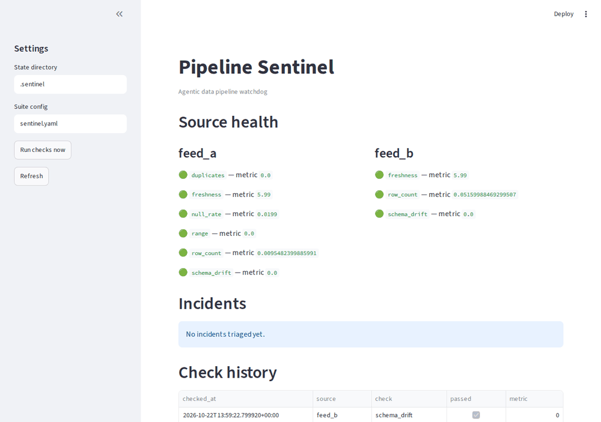

# Pipeline Sentinel

[](https://github.com/DonEngineer/pipeline-sentinel/actions/workflows/ci.yml)


An **agentic data pipeline watchdog**: scheduled checks watch your data sources for volume drops, stale batches, schema drift, and quality regressions — then an LLM triage agent correlates the failures into one incident with severity and a probable root cause, instead of spamming raw alerts.

Silent pipeline failures are usually discovered by the customer. This project is the watchdog you wish you had: deterministic checks where exactness matters, agentic judgment where noise needs reducing. Everything runs local for $0.



## How it works

```
            ┌──────────────┐
            │   Sources    │──► SQL Server / SQLite tables
            └──────┬───────┘
                   ▼
            ┌──────────────┐
            │    Checks    │──► volume · freshness · schema · quality
            └──────┬───────┘
                   ▼
            ┌──────────────┐    all pass
            │ Rule engine  │──────────────► log + dashboard (green)
            └──────┬───────┘
                   │ failures
                   ▼
            ┌──────────────┐
            │ Triage agent │──► correlate → severity → root cause → alert
            └──────────────┘         (LangGraph + local LLM)
```

Design principle: **deterministic where it must be exact** (checks, thresholds), **agentic where judgment helps** (triage, correlation, alert text). The LLM never silently suppresses a failure — rules are the gate, the agent is the analyst.

## Features

- 🔍 Deterministic checks: row-count vs baseline, freshness, schema drift, null rates, duplicates, value ranges
- 🗂️ YAML check suites: declare per-source checks and thresholds in `sentinel.yaml`
- 🗄️ SQLAlchemy sources: SQL Server in production, SQLite for the local demo
- 🤖 LangGraph triage agent: correlates failed checks into incidents with severity, probable cause, and suggested action
- ⏰ Scheduled runs via APScheduler, with LLM triage per run
- 📊 Streamlit dashboard: source health, check history, incidents
- 🧪 Eval harness: synthetic anomaly injection, detection vs false-positive metrics

## Quickstart

**Prerequisites:** Python 3.11+.

```bash
# 1. Install
pip install -e ".[dev]"

# 2. Build the demo database (two feeds, 14 days of healthy history)
python -m pipeline_sentinel.seed --db data/demo.db

# 3. Run the check suite  (M1/M2)
python -m pipeline_sentinel.cli check --config sentinel.yaml
# or a single source: --config sentinel.yaml --source feed_a
```

To watch it catch real anomalies, delete half of today's rows from `feed_b` (volume check fails) or push some `amount` values above 10000 in `feed_a` (range check fails) — each failure reports its deviation in the details.

Check suites are declared in `sentinel.yaml`: per source, list the checks to run with their thresholds. Unknown check names fail fast with a clear error.

```bash
# 4. Triage failures into incidents  (M3, requires Ollama running)
python -m pipeline_sentinel.cli triage --config sentinel.yaml
```

Severity is scored by deterministic rules (stale data or collapsed volume → critical); the LLM correlates the failed checks into one incident with a probable cause and a suggested action. Incidents are logged to `.sentinel/incidents.jsonl`.

```bash
# 5. Watch continuously  (M4)
python -m pipeline_sentinel.cli watch --config sentinel.yaml --interval 60
```

Runs the suite (and triage) immediately, then every `--interval` minutes. Use `--no-triage` to skip the LLM step.

```bash
# 6. Open the dashboard  (M4)
streamlit run app/streamlit_app.py
```

Shows source health from the latest check per source, triaged incidents with severity and root cause, and the full check history — plus a "Run checks now" button.

Copy `.env.example` to `.env` to override thresholds, the state directory, or the Ollama model.

## Demo walkthrough

The 60-second story this repo tells: everything is green, something breaks,
the agent files one incident instead of spamming alerts.

```bash
# 1. Seed two weeks of healthy demo data
python -m pipeline_sentinel.seed --db data/demo.db

# 2. All green
python -m pipeline_sentinel.cli check --config sentinel.yaml

# 3. Break it: drop half of the latest feed_a batch
python -c "from pipeline_sentinel.eval.injectors import drop_today; drop_today('data/demo.db', 'feed_a', fraction=0.5)"
python -m pipeline_sentinel.cli check --config sentinel.yaml   # feed_a.row_count FAILs

# 4. Triage the failure into one incident  (needs Ollama running)
python -m pipeline_sentinel.cli triage --config sentinel.yaml

# 5. How well does it detect? Run the eval harness (no LLM needed)
python -m pipeline_sentinel.cli eval --config sentinel.yaml
# 7 scenarios, 6/6 expected failures caught, 0 false positives

# 6. Restore the demo data and open the dashboard
python -m pipeline_sentinel.seed --db data/demo.db
streamlit run app/streamlit_app.py
```

## Project structure

```
src/pipeline_sentinel/
├── checks/        Deterministic checks: volume, freshness, schema, quality  (M1)
├── sources/       SQLAlchemy source connector (SQL Server / SQLite)        (M1)
├── history.py     Append-only JSONL log of check results                    (M1)
├── seed.py        Demo database generator                                    (M1)
├── cli.py         check command (YAML suite runner)                          (M2)
├── suite.py       Suite YAML loading + check registry                        (M2)
├── triage/        LangGraph triage agent: severity + cause + action            (M3)
├── scheduler/     APScheduler wiring: run-once + interval runs                 (M4)
sentinel.yaml      Example check suite                                        (M2)
app/               Streamlit dashboard: health, incidents, history                (M4)
eval/              Anomaly-injection eval harness                             (M5)
data/              Demo databases (gitignored)
.sentinel/         Schema snapshots + check history (gitignored)
.ai/               Handoff docs for AI-assisted development
```

## Roadmap

| Milestone | Status |
|---|---|
| M1 Check engine: sources, checks, history, seed, CLI | ✅ Done |
| M2 Anomaly rules: duplicates, ranges, configurable suites | ✅ Done |
| M3 LangGraph triage agent: correlate → severity → root cause | ✅ Done |
| M4 Scheduler + Streamlit dashboard | ✅ Done |
| M5 Eval harness (synthetic anomaly injection) + polish | ✅ Done |

Stretch goals: Great Expectations integration, webhook/PagerDuty alerts, dbt source support.

## Tech stack

| Layer | Choice | Why |
|---|---|---|
| Checks | SQLAlchemy + hand-rolled rules | Deterministic, testable, no heavy deps |
| Triage | LangGraph + Ollama | Agentic correlation, free and local |
| Scheduling | APScheduler | In-process, zero infra |
| Dashboard | Streamlit | Fastest credible demo |
| Evals | Custom harness | Transparent detection/false-positive metrics |

## License

MIT — see [LICENSE](LICENSE).
